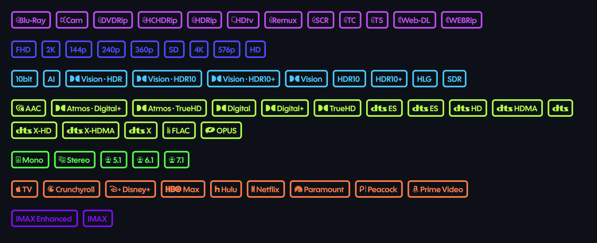
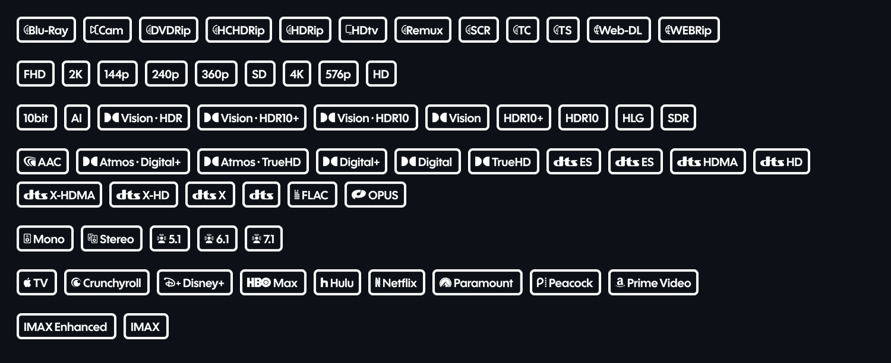
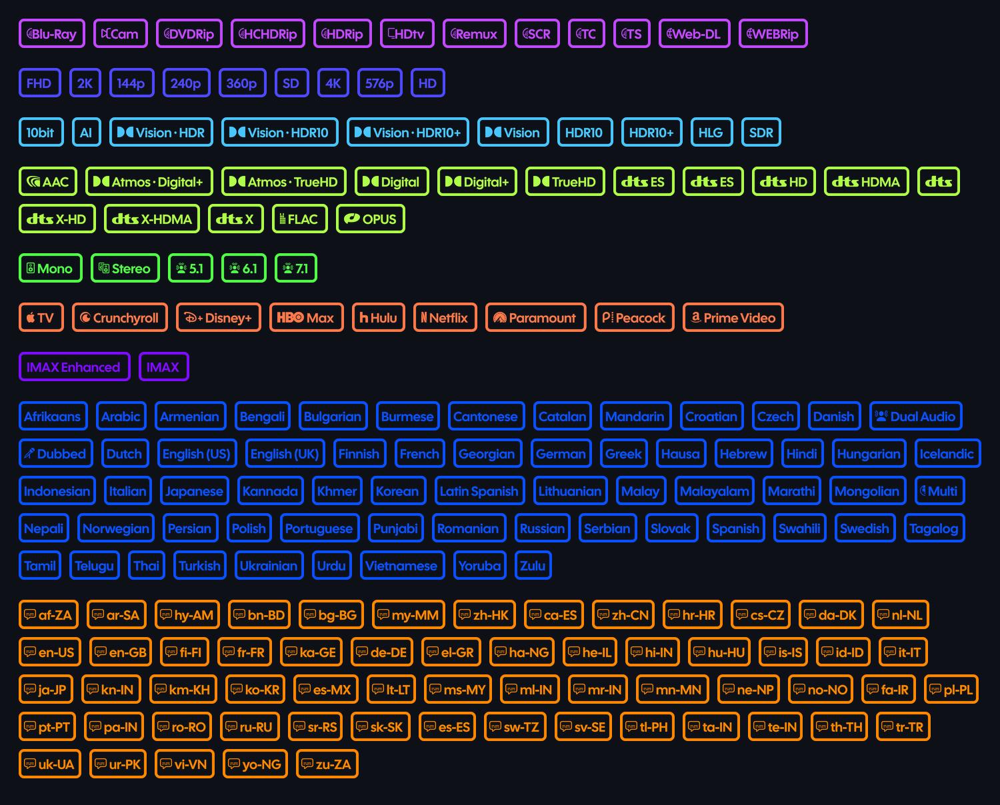
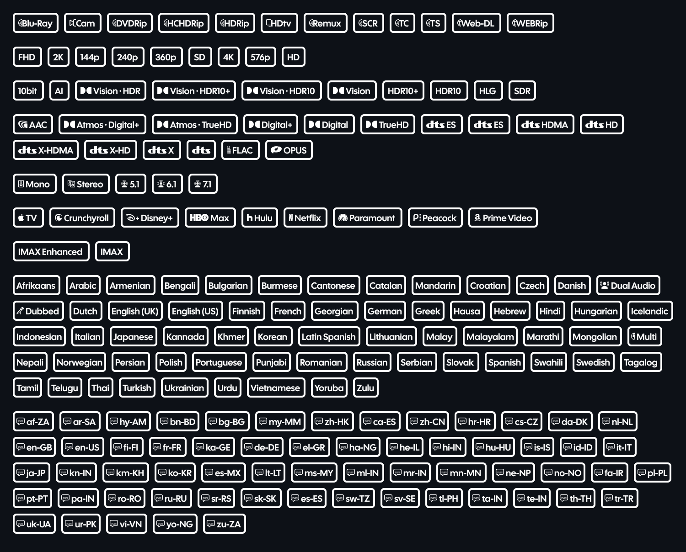

# Badgers
a [Nuvio](https://github.com/NuvioMedia) badges collection that was designed by a human, not by ChatGPT Luna ... ⏰
cause... we hate AI slop, don't we?
> I have to say that, even tho this project mentions AI hate, Claude Code was used to bring this to life. I simply don't understand GitHub. But hey, atleast the badges are human, not like SOME other badge collections that are 100% AI made!

fork of [Kingsize's badges](https://github.com/kingsizew/badges) (just used for base to which badges i had to make)
> [!NOTE]
> If you're lazy enough, [click here](#get-your-badges-i-know-you-want-them) to see links to the badges
## Types of the badges
Badgers come in two versions (1 and 2) with two variants (white and color). Four in total.
### Type1Color

A color variant with
- Visual
- Quality
- Resolution
- Audio
- Channels
- Streaming platforms
- and IMAX?
### Type1White

The same as [Type1Color](https://github.com/k-flop/badgers/#type1color), but white... obviously 
### Type2Color

Ooooh, it's no longer Type 1!! It's gonna be so exciting!! Not really :( Just two more additions
- Languages
- Subtitle Languages
### Type2White

You're gonna be surprised when I say this...........

The same as [Type2Color](https://github.com/k-flop/badgers#type2color) but white

# Get your badges.... I know you want them...
Just copy the link to the following and add them in Nuvio On mobile, go to Settings > Layout > Streams > Fusion badge URLs Or if you're on a desktop uhh... I don't know you tell me on [this discussion](https://github.com/k-flop/badgers/discussions/3)

### All collection links

**Type1Color**
- Color outline: color badges, transparent tag, colored border `https://raw.githubusercontent.com/k-flop/badgers/main/colored_outline_badges.json`
- Tinted: color badges on a faint tinted fill `https://raw.githubusercontent.com/k-flop/badgers/main/tinted_badges.json`

**Type1White**
- White outline on dark `https://raw.githubusercontent.com/k-flop/badgers/main/white_badges.json`
- White badges with colored borders `https://raw.githubusercontent.com/k-flop/badgers/main/badge.json`
- White badges on a solid black tag `https://raw.githubusercontent.com/k-flop/badgers/main/black_badges.json`

**Type2Color**
- Color outline `https://raw.githubusercontent.com/k-flop/badgers/main/colored_outline_badges_v2.json`
- Tinted `https://raw.githubusercontent.com/k-flop/badgers/main/tinted_badges_v2.json`

**Type2White**
- White outline on dark `https://raw.githubusercontent.com/k-flop/badgers/main/white_badges_v2.json`
- White badges with colored borders `https://raw.githubusercontent.com/k-flop/badgers/main/badge_v2.json`
- White badges on a solid black tag `https://raw.githubusercontent.com/k-flop/badgers/main/black_badges_v2.json`

random appreciation message for Kingsize, for making the foundation of this badge collection
> psst... do you want a type 3? a version without streaming badges? tell me!
